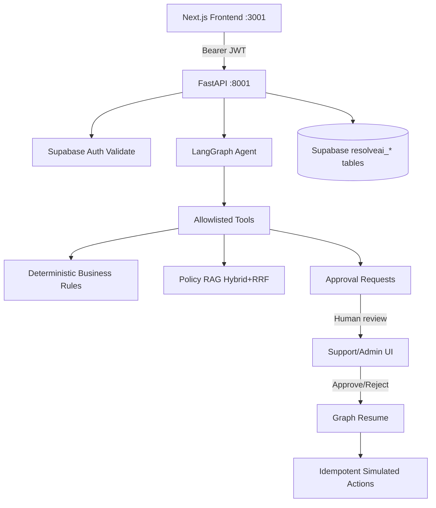

# ResolveAI Architecture

## Design principles

- Frontend never executes business logic.
- LLM can propose tool calls; graph + Python validate and execute.
- Sensitive actions require customer confirmation + staff approval.
- Shared Supabase project with KnowledgePilot, isolated `resolveai_*` namespace.
- Gemini primary, Groq fallback for agent decisions.
